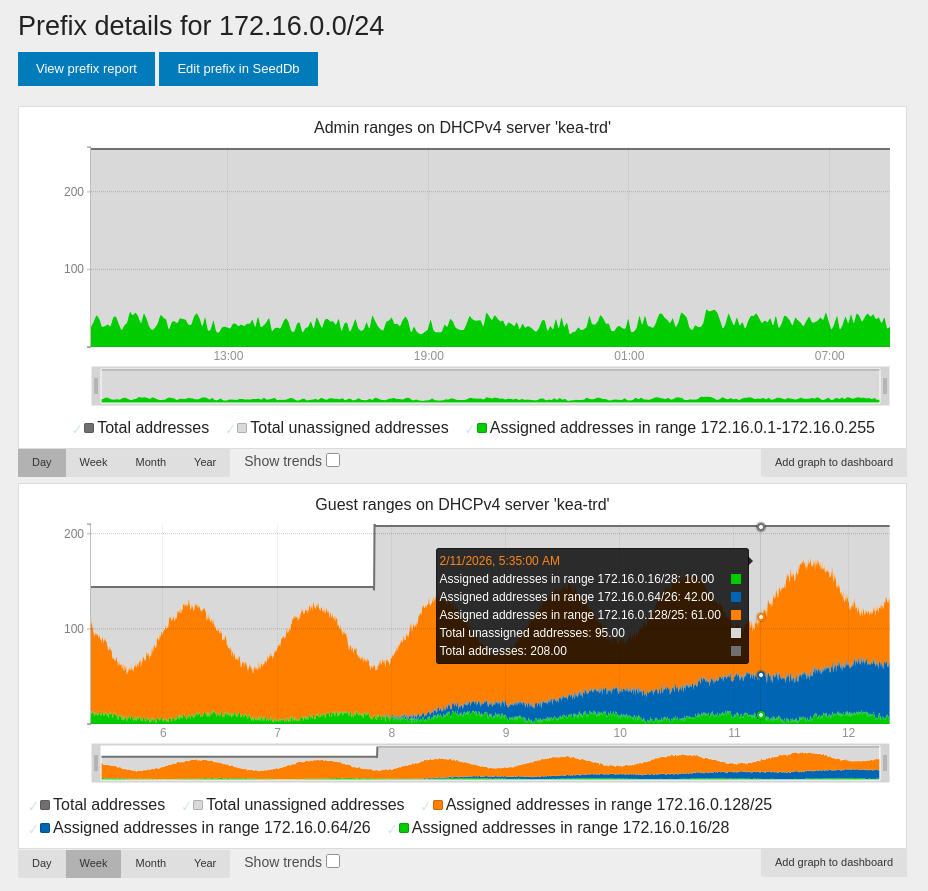

==========
DHCP Stats
==========

Introduction
============

What DHCP servers are supported?
--------------------------------

NAV can request, collect, and display stats from DHCP servers if they expose an
API for fetching stats. Alternatively, if a DHCP server does not expose an API
for fetching stats, a standalone script running on the DHCP server itself can
send stats directly to NAV's Graphite/Carbon timeseries database backend,
alleviating the need for NAV to request and collect stats at the cost of extra
maintenance for the administrator.

NAV currently supports collecting stats from one DHCP server implementations:

:ref:`kea_dhcpv4_servers`
   Configure at minimum a Kea DHCPv4 HTTP/HTTPS control socket, and assign each
   pool in the Kea DHCPv4 configuration unique pool IDs, and NAV can start
   collecting IPv4 stats from each Kea DHCPv4 pool over the control socket.

.. _dhcpstats_nav_terminology:

What DHCP terminology does NAV use?
-----------------------------------
DHCP server implementations seem to use certain DHCP terms in slightly different
ways. To avoid confusion, here's all the DHCP terms that NAV uses.

Subnet
  A subnet.
Pool
  An arbitrary set of IP addresses that a DHCP server can use when allocating IP
  addresseses to a certain class of clients on that subnet.
Range
  The set of all IP addresses that are greater than or equal to some IP address
  and smaller than or equal to some other IP address that a DHCP server can use
  when allocating IP addresseses to a certain class of clients on that subnet.
Server name
  Name of a DHCP server instance, e.g. *kea-dhcp4-oslo*. Due to restrictions in
  the Graphite/Carbon timeseries database, the name should only consist of
  English letters, digits, hyphens, and underscores.
Group name
  Name of a group of either subnets, pools, or ranges configured on a server
  instance that NAV should display together. Due to restrictions in the
  Graphite/Carbon timeseries database, the name should only consist of English
  letters, digits, hyphens, and underscores.

.. note::

   When stats are collected, NAV will translate any terms used by external DHCP
   servers to the corresponding term used in NAV.

   For example, any mention of "pool" in data from a Kea DHCPv4 server will be
   presented in the NAV web UI as "range". Any mention of "range" in in data
   from a ISC DHCP server would have been presented in the NAV web UI as
   "range". Any mention of "pool" in data from a MikroTik RouterOS v7 DHCP
   server would have been presented in the NAV web UI as "pool", etc.

.. note::

   The term *group name* is not really a term used by any DHCP server, but many
   DHCP servers do have a mechanism for grouping together similar subnets,
   pools, and/or ranges under a common name.
   By default, each range/pool/subnet is assigned to its own unique group.

What DHCP stats are collected?
------------------------------
Total addresses (IPv4)
   The total amount of IP addresses controlled by the DHCP server on a per
   range/pool/subnet basis.
Assigned addresses (IPv4)
   The amount of IP addresses that are in use (assigned to clients or used by
   misbehaving clients) on a per range/pool/subnet basis.
Unassigned addresses (IPv4)
   The amount of IP addresses that are not in use (the difference between total
   and assigned addresses) on a per range/pool/subnet basis.
Declined addresses (IPv4)
   The amount of IP addresses that are used by misbehaving clients (and thus not
   available for assignment) on a per range/pool/subnet basis. (This stat is
   currently not used in NAV.)

NAV collects these stats on a per range basis if possible. If that is not
possible, it collects on a per pool basis if possible. If that is not possible
either, it collects stats on a per subnet basis if possible.

Where can I see collected DHCP stats in NAV?
--------------------------------------------

DHCP stats are displayed in two types of pages in the NAV web UI you're probably
already familiar with:

* **VLAN pages**. The stats collected for a group of ranges/pools/subnets are
  displayed on a specific VLAN's page if at least one IP address contained in
  the group also is contained in that VLAN.

* **Prefix pages**. The stats collected for a group of ranges/pools/subnets are
  displayed on a specific Prefix's page if at least one IP address contained in
  the group also is contained in that Prefix.

Below is an example depicting how stats collected for two groups of ranges,
"Guest" and "Admin" on the DHCP server "kea-trd", are displayed on the page for
the prefix ``172.16.0.0/24``. (Note how "Guest" and "Admin" are two separate
private networks occupying the same private address space on the DHCP server;
but since the range ``127.16.0.1-127.16.0.255`` is collected under the group
name "Guest", and the rest of the ranges are collected under the group name
"Admin", the stats from the different private networks are separated correctly
and won't interfere with each other. This separation would also have worked if
the stats came from separate servers, even if they had the same group name. So
you should only worry about stats from different private networks interfering
with each other if all stats come from the same server *and* has the same group
name.)

Configuration
=============

See the howto: :doc:`/howto/setup-and-configure-dhcpstats`.
